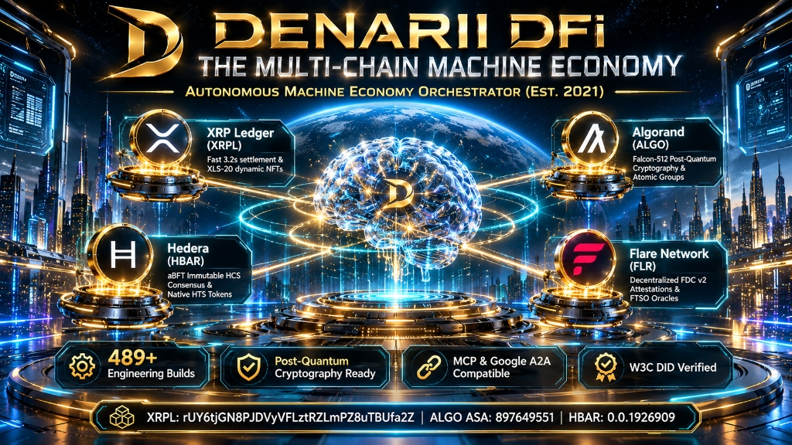

# Denarii DFi — Machine Economy & Agentic Infrastructure

> **Autonomous multi-chain machine economy orchestrator, agentic collaboration rails, and post-quantum cryptographic infrastructure operating across XRPL, Algorand, Hedera, and Flare.**  
> *Founded in 2021 | 489+ Engineering Videos | 30,000+ Community Posts | Multi-Chain DLT Settlement*

  

---

## Overview

**Denarii DFi** is an open agentic framework and sovereign machine economy orchestrator designed to decouple high-level AI cognition from deterministic on-chain execution and policy firewalls.

- **Proof Before Promises**: Real-time cryptographic evidence, hardware attestations, and deterministic settlement.
- **Sovereign Privacy**: Zero private key egress; 100% browser-local credential custody and hardware-isolated execution.
- **Post-Quantum Readiness**: Native tracking and integration of quantum-resistant schemes (Algorand Falcon-512, XRPL ML-DSA-44 proposals, Hedera SHA-384 / FN-DSA-1024).

---

## Documentation Index

- [Flagship Positioning & Press Release](docs/PRESS_RELEASE_2026.md): Official technical press release and multi-chain architecture statement.
- [Architecture & 8-Stage Lifecycle](docs/ARCHITECTURE.md): Complete breakdown of decoupled agent cognition, deterministic policy firewalls, and multi-chain execution.
- [Token Registry & Multi-Chain Rails](docs/TOKEN_REGISTRY.md): Verified on-chain identifiers, issuer accounts, and network specializations.
- [Post-Quantum Cryptography & Security](docs/PQC_SECURITY.md): Quantum-resistant cryptographic standards, NIST milestones, and ledger postures.
- [Agentic Protocols: MCP & Google A2A](docs/AGENTIC_PROTOCOLS.md): Model Context Protocol tool routing and Google Agent2Agent specifications.
- [Contributing Guide](CONTRIBUTING.md): How to submit proposals, report findings, and join developer challenges.

---

## Official Ecosystem Properties

| Resource | URL | Description |
|---|---|---|
| **Live Orchestrator** | [denarii-orchestrator.netlify.app](https://denarii-orchestrator.netlify.app) | Flagship 60 FPS 3D WebGL orchestrator, live agent harnesses, and multi-chain settlement workbench |
| **Main Website** | [denariidfi.net](https://denariidfi.net) | Canonical portal and ecosystem overview |
| **Architecture Explainer** | [info-denarii-orchestrator.netlify.app](https://info-denarii-orchestrator.netlify.app) | Detailed technical breakdown of the orchestrator architecture |
| **Token Portal** | [buy-denarii-dfi-tokens.netlify.app](https://buy-denarii-dfi-tokens.netlify.app) | Official token acquisition and liquidity guides |
| **AI Influencers United** | [Talent Directory](https://denarii-orchestrator.netlify.app/?tab=ai-influencers-united&join=true) | Directory of verifiable agent nodes, digital twins, and swarm personas |
| **One Million Developers** | [onemilliondevs.netlify.app](https://onemilliondevs.netlify.app) | Developer onboarding, bounties, and open builder challenges |
| **Link Hub** | [linktr.ee/DenariiDFi](https://linktr.ee/DenariiDFi) | Universal verified ecosystem directory |
| **YouTube Channel** | [@Denarii_DFI_Build](https://www.youtube.com/@Denarii_DFI_Build) | 450+ engineering videos and walkthroughs since 2021 |
| **X / Twitter** | [@Denarii_DFI](https://x.com/Denarii_DFI) | 30,000+ technical updates and community commentary |
| **Discord** | [Join Community](https://discord.gg/zCw4sCCDHD) | Developer and community forum |

---

## Verified Cross-Chain Token Registry

Denarii DFi operates across multi-chain settlement rails. Verify all transactions against our canonical on-chain identifiers:

| Network | Standard | Identifier | Explorer Link |
|---|---|---|---|
| **XRP Ledger (XRPL)** | Native Token / Account | `rUY6tjGN8PJDVyVFLztRZLmPZ8uTBUfa2Z` | [View on XRPL Explorer](https://xrpscan.com/account/rUY6tjGN8PJDVyVFLztRZLmPZ8uTBUfa2Z) |
| **Algorand** | Algorand Standard Asset (ASA) | `897649551` | [View on Pera Explorer](https://explorer.perawallet.app/asset/897649551/) |
| **Hedera Hashgraph** | Hedera Token Service (HTS) | `0.0.1926909` | [View on HashScan](https://hashscan.io/mainnet/token/0.0.1926909) |

---

## Agentic & Developer Integration

The Denarii DFi Orchestrator supports standard machine protocols:

- **Model Context Protocol (MCP)**: Native tool catalog for agent swarms and tool dispatchers.
- **Agent2Agent (A2A) Protocol**: Public Agent Card manifest available at `https://denarii-orchestrator.netlify.app/.well-known/agent.json`.
- **XRPL Domain Verification**: XLS-26 domain binding active at `https://denarii-orchestrator.netlify.app/.well-known/xrp-ledger.toml`.
- **AI Answer Engine Context**: Full markdown documentation for LLMs available at `https://denarii-orchestrator.netlify.app/llms.txt`.

---

## License

This documentation and public interface specification is licensed under the [MIT License](LICENSE).
